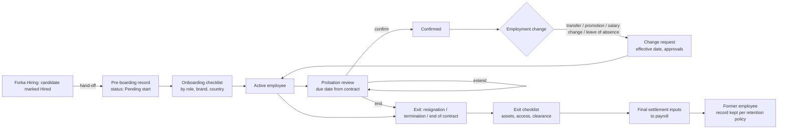
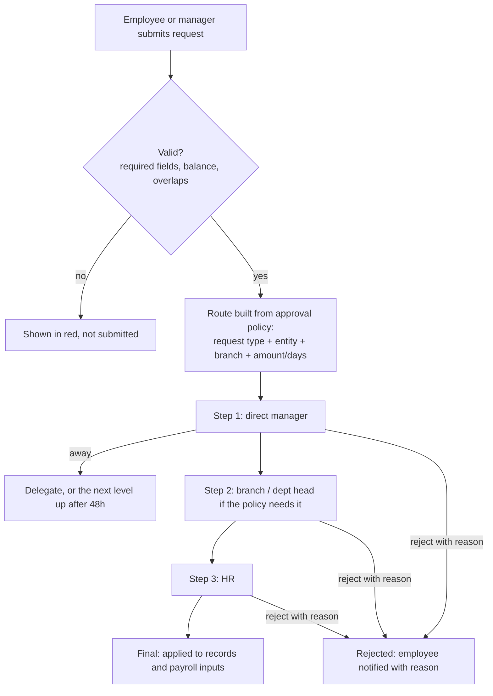
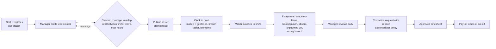

# 02. Process maps

Diagrams use Mermaid (GitHub shows them as pictures). Each map shows the steps, who does each step,
and the system record each step creates. "Audit" means a time-stamped, permanent entry in the audit log.

## 2.1 Employee lifecycle (from approved hire to exit)

Rules:
- Every change (transfer, promotion, salary change, leave of absence, termination) is a **change request with an effective date**. Nothing overwrites history. On the effective date, a new row is added to the employment history.
- Changes dated in the future show as "Scheduled" and apply automatically on that date. Changes dated in the past need HR Manager approval and are flagged for payroll.
- A transfer between legal entities ends one employment and starts another, linked to the same person. This keeps payroll, end-of-service and documents clean for each entity.

## 2.2 Approval routing (shared by every request type)

- The employee always sees each step, who must act now, and since when.
- A person cannot approve their own request. If the manager is also the requester, it goes to the next level.
- Approval policies are configured data, not code. Changing them is itself audited.

## 2.3 Leave

1. Employee picks a type and dates. The app shows the balance before and after, and public holidays and rest days that fall in the range.
2. Checks: balance, overlap with existing leave, notice period, blackout dates (for example Eid or peak periods, set per branch), team coverage warning for the manager.
3. Approval route (2.2). On approval the leave ledger is debited, the roster shows the person as on leave, and payroll inputs are updated if the leave is unpaid or affects pay.
4. Cancelling approved leave needs approval if the leave has started. Ledger entries are reversed, never deleted.

## 2.4 Shifts and attendance (daily)

- Raw punches are never edited. A correction is a new record that points to the punch or shift it corrects, with reason and approver.
- Overnight shifts belong to the day the shift started.
- Offline clock-in on a phone is stored on the device with its time and location and synced when the connection returns. Late-synced punches are marked as such.

## 2.5 Document expiry

1. Documents are stored with type, number, issue date, expiry date and owner.
2. A daily job finds documents within each reminder window (configurable per document type, for example 90 / 60 / 30 / 7 days and on expiry).
3. Reminders go to the employee, the manager and HR, according to the document type settings.
4. When a renewed document is uploaded and verified by HR, the old one is marked "Replaced" and reminders stop.
5. Expired documents appear on the HR and branch dashboards until resolved.

## 2.6 Month-end payroll (inputs workflow, Release 1)

```mermaid
flowchart LR
  C1[Attendance cut-off date<br/>per pay group] --> C2[Exceptions review<br/>managers clear open items]
  C2 --> C3[HR locks period]
  C3 --> C4[Payroll input draft:<br/>earnings, deductions, OT, unpaid leave,<br/>joiners, leavers, changes]
  C4 --> C5[Variance report vs last month<br/>every change explained]
  C5 --> C6[Approval: HR Manager, then Finance, then CEO]
  C6 --> C7[Export: payroll provider / WPS / accounting]
  C7 --> C8[Payslips released to employees]
  C8 --> C9[Period archived, audit record sealed]
```

- After the period is locked, late changes go into the next period as adjustments, with a reference to the original period.
- Reopening a locked period needs HR Manager and Finance approval, and the reason is recorded.

## 2.7 HR requests desk (Phase 3)

Request → category (letter, payslip question, document update, policy question, grievance, other) → owner →
response target → resolution → employee confirms. Sensitive categories (grievance, medical, disciplinary)
are visible only to the case owner and approved HR roles, never to the employee's manager by default.
