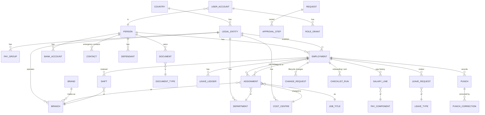

# 04. Data model

PostgreSQL. All tables have `id` (UUID), `created_at`, `created_by`, `updated_at`, `updated_by`.
Tables holding company data also carry `entity_id`, which row-level security uses to separate legal entities ([06](06-security.md)).
Names are stored in English and Arabic (`name_en`, `name_ar`).

## 4.1 Principles

- **One person, many employments.** `person` holds who someone is. `employment` holds one period of work with one legal entity. A transfer between entities closes one employment and opens another.
- **History by effective date.** Job, branch, manager, cost centre and salary are stored in rows with `effective_from` and `effective_to`. The current value is the row whose range covers today. Nothing is overwritten.
- **Ledgers, not counters.** Leave balances are the sum of ledger entries (accrual, taken, adjustment, carry-over, expiry). A balance can always be explained line by line.
- **Raw and corrected kept apart.** Punches are never changed. Corrections are separate rows.
- **Configuration as data.** Leave types, approval policies, reminder windows, salary components and country rules are rows with versions and effective dates, not code.
- **Soft delete only** for business records. Real deletion only through the retention and erasure workflow ([06 §6](06-security.md#6-privacy-retention-and-data-subject-requests)).

## 4.2 Entity diagram (core)

## 4.3 Tables (Phase 1)

**Organisation**
- `country` (code AE / OM, name_en, name_ar, currency, week_start, default_rest_days)
- `legal_entity` (country_id, legal_name_en/ar, trade_licence_no, labour_establishment_no, currency, status)
- `brand` (name_en/ar, logo_file_id)
- `branch` (entity_id, brand_id, name_en/ar, address, latitude, longitude, geofence_radius_m, timezone, status)
- `department`, `cost_centre` (entity_id, code, accounting_code), `job_title` (name_en/ar, grade, job_family), `pay_group` (entity_id, currency, frequency, cut_off_day)
- `public_holiday` (country_id, date, name_en/ar, applies_to_entity_ids, source, status: provisional / confirmed)

**People and employment**
- `person` (legal names en/ar, preferred name, date_of_birth, gender, nationality, marital_status, personal_email, mobile, photo_file_id). Sensitive identifiers encrypted at field level.
- `employment` (person_id, entity_id, employee_no, start_date, contract_type, contract_end_date, probation_end_date, status: pending_start / active / on_leave_of_absence / notice / exited, exit_date, exit_reason, hire_source_ref)
- `assignment` (employment_id, job_title_id, branch_id, department_id, cost_centre_id, manager_employment_id, work_location, fte, effective_from, effective_to, change_request_id)
- `pay_component` (entity_id, code, name_en/ar, type: earning / deduction, taxable_flags, wps_category, country_rule_id)
- `salary_line` (employment_id, pay_component_id, amount (encrypted), currency, effective_from, effective_to, change_request_id)
- `bank_account` (person_id, bank_name, iban (encrypted), account_name, wps_routing, verified_by, verified_at, effective_from)
- `contact` (emergency contacts), `dependant` (name, relationship, dob, document links)
- `change_request` (employment_id, type: transfer / promotion / salary / loa / termination / confirmation / probation_extension, payload JSON, effective_date, status, request_id)

**Documents and checklists**
- `document_type` (code, name_en/ar, applies_to_country, requires_expiry, reminder_days [90,60,30,7,0], notify_employee/manager/hr, sensitivity class)
- `document` (person_id, employment_id, type_id, number (encrypted), issue_date, expiry_date, issuing_country, file_id, status: pending_verification / valid / expired / replaced / rejected, verified_by, replaced_by_id)
- `file` (storage_key, sha256, size, mime, uploaded_by, virus_scan_status, encryption key reference)
- `checklist_template` (kind: onboarding / exit, conditions: country, entity, brand, job_family), `checklist_item_template` (owner role, due offset days, required)
- `checklist_run`, `checklist_item` (status, done_by, done_at, evidence_file_id)
- `letter_template` (code, language, body with placeholders, version, approved_by), `letter_issue` (employment_id, template version, file_id, issued_by)

**Leave**
- `leave_type` (country_id / entity_id, code, name_en/ar, paid %, accrual rule ref, carry-over max, requires_document_after_days, gender/eligibility rules, country_rule_id)
- `leave_ledger` (employment_id, leave_type_id, date, days (+/-), kind: accrual / taken / adjustment / carry_over / expiry / reversal, source_ref)
- `leave_request` (employment_id, leave_type_id, start, end, half_day flags, days_calculated, reason, attachment_file_id, request_id)

**Time**
- `shift_template` (branch_id, name, start, end, breaks, crosses_midnight)
- `roster_week` (branch_id, week_start, status: draft / published, published_by/at, version)
- `shift` (roster_week_id, employment_id, branch_id, date, start_at, end_at (timestamptz), segments for split shifts, role, status)
- `clock_device` (branch_id, kind: tablet / biometric / mobile, identifier, status, last_seen_at)
- `punch` (employment_id, at (timestamptz), kind: in / out, source, device_id, latitude, longitude, accuracy_m, inside_geofence, synced_late, raw_payload)
- `attendance_day` (employment_id, work_date, matched shift, worked_minutes, late_minutes, ot_minutes, exceptions[], status: open / approved / locked) — calculated, rebuilt from punches and corrections
- `punch_correction` (employment_id, work_date, corrects_punch_id, new_at, kind, reason, request_id)

**Workflow, access, audit**
- `approval_policy` (request_type, conditions JSON, steps JSON, version, effective_from, approved_by)
- `request` (type, requester, subject_employment_id, status, current_step, sla_due_at)
- `approval_step` (request_id, order, approver_rule, assigned_to, acted_by, on_behalf_of, action, comment, acted_at)
- `user_account` (person_id, sign-in methods, status, last_sign_in), `device_binding` (user_account_id, device fingerprint hash, created_at, revoked_at)
- `role_grant` (user_account_id, role, scope_type, scope_id, data_classes, valid_from, valid_to, granted_by)
- `notification` (recipient, channel, template, payload, status, attempts)
- `audit_event` (append-only: at, actor, on_behalf_of, action, table, record_id, entity_id, before JSON, after JSON, ip, user_agent, request_id, prev_hash, hash)
- `access_log` (append-only: at, actor, subject_person_id, data_class, fields, purpose, screen)
- `integration_run` / `integration_message` (see [07](07-integrations.md))
- `import_batch`, `import_row` (template version, row data, validation errors, status, committed_by)

## 4.4 Later phases (outline)

- **Payroll:** `pay_period`, `payroll_input` (employment, component, amount, source: salary / attendance / leave / adjustment / settlement), `payroll_run`, `payroll_variance`, `payslip` (file, released_at), `export_file`, `advance`, `final_settlement_input`.
- **Performance:** `review_cycle`, `scorecard_template` (by job family), `objective`, `competency`, `review`, `review_rating` (versioned), `development_plan`.
- **Learning:** `course` (required_for job families, validity months), `training_record` (completed_on, expires_on, certificate_file_id).
- **HR desk:** `case` (category, sensitivity, owner, sla, status), `case_note` (visibility), `policy`, `policy_acknowledgement` (person, policy version, acknowledged_at, method).

## 4.5 Import templates

Controlled CSV/XLSX templates, versioned (`employees_v1`, `assignments_v1`, `salary_v1`, `documents_v1`, `leave_opening_balances_v1`).
Import runs in two steps: **validate** (every error per row and column, nothing saved) and **commit** (all or nothing, by an HR Manager).
Every committed batch can be traced in `import_batch`, and every row change is in the audit log.
